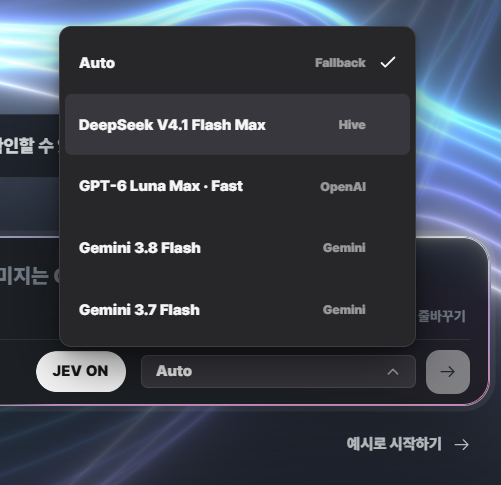
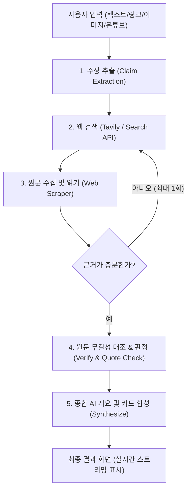

  

  # True or Not (팩트검증 에이전트)

  
<em>"근거 없는 단정 대신, 투명한 출처와 원문으로 판단을 돕습니다."</em>

  
True or Not은 뉴스·SNS·유튜브·댓글 속 주장을 분해하고, 공신력 있는 원문 근거와 대조하여 진위 여부를 다각도로 검증해 주는 <strong>생활형 팩트체크 AI 서비스</strong>입니다.

  

    
    
  

---

## 왜 True or Not인가요?

하루에도 수많은 뉴스, 자극적인 유튜브 썸네일, 건강 민간요법, 주식 추천 글이 쏟아집니다.
* *"양파즙이 당뇨에 특효약이라는데 진짜일까?"*
* *"이 연예인 관련 루머 기사는 사실일까?"*
* *"AI 챗봇에게 물어봤더니 그럴싸하게 거짓말(환각)을 하진 않을까?"*

**True or Not은 정답을 독단적으로 선언하지 않습니다.**  
대신, 주장을 쪼개어 공신력 있는 웹 문서를 직접 찾아 읽고, **"실제 웹 문서에 적힌 원문 인용"**과 함께 확인된 사실과 불확실한 부분을 투명하게 보여주어 **사용자가 스스로 확신을 갖고 판단할 수 있도록 돕습니다.**

---

## 핵심 기능

### 1. 무엇이든 편하게 입력하세요
- **텍스트 입력**: 의심스러운 글이나 댓글, 메시지를 그대로 복사해 붙여넣으세요.
- **웹 링크(URL)**: 뉴스 기사나 블로그 글 링크만 넣어도 본문을 자동으로 가져와 검증합니다.
- **유튜브 링크**: 유튜브 영상 링크를 입력하면 자막을 자동 추출하여 발언 내용의 진위를 대조합니다.
- **이미지 업로드**: 캡처된 스크린샷 속 텍스트도 인식하여 검증을 진행합니다.

### 2. 복합 주장의 자동 분해
한 문장에 여러 주장이 섞여 있어도 괜찮습니다.
- *"A사는 3분기 흑자전환에 성공했고, 신약 임상 3상도 통과했다"*  
  - **주장 1 (실적)**과 **주장 2 (임상)**로 자동 분리하여 각각 따로 팩트체크합니다.

### 3. 가짜 인용(환각)을 원천 차단하는 원문 대조
- LLM이 임의로 꾸며낸 문장은 철저히 걸러냅니다.
- 검색된 실제 웹페이지 원문 텍스트 내에 **실제로 존재하는 문장만 추출·교정**하여 인용구로 제시합니다.
- 만약 검색된 근거가 부족하거나 접근할 수 없다면, 스스로 검색어를 보완하여 **최대 1회 자동 재탐색(Self-Correction)**을 수행합니다.

### 4. 7단계 투명한 판정 카드
단순한 "O / X" 흑백논리를 넘어, 상황에 맞는 정밀한 판정을 제공합니다.

| 판정 결과 | 의미 |
| :--- | :--- |
| **사실 (True)** | 신뢰할 수 있는 다수의 원문 근거와 정확히 일치함 |
| **대체로 사실 (Mostly True)** | 핵심 내용은 사실이나 미세한 차이 또는 부가 맥락이 필요함 |
| **절반의 사실 (Half True)** | 일부는 사실이나 중요한 맥락이 빠져 있어 오해의 소지가 있음 |
| **대체로 사실 아님 (Mostly False)** | 사실인 내용이 일부 포함되어 있으나 전반적으로 왜곡됨 |
| **사실 아님 (False)** | 공신력 있는 출처의 사실과 명백히 배치됨 |
| **근거 부족 (Insufficient Evidence)** | 신뢰할 만한 공개 출처가 부족함 (*거짓이라는 뜻이 아닙니다*) |
| **검증 대상 아님 (Not a Claim)** | 단순한 개인 의견, 주관적 감상, 미래 예측 발언 |

### 5. JEV 빠른 판정 및 유연한 모델 선택 (Auto Fallback)

  

사용자의 검증 목적과 환경에 맞게 모델과 검증 모드를 자유롭게 선택할 수 있습니다.

- **JEV (Just Enough Verification) 모드**: 긴 종합 분석 대신 핵심 주장 판정과 신뢰도 점수만 빠르게 산출하는 고속 검증 모드입니다.
- **다양한 고성능 LLM 지원**: Hive API 기반의 DeepSeek부터 OpenAI GPT, Google Gemini까지 최신 모델을 직접 선택하여 검증할 수 있습니다.
- **Auto Fallback (자동 장애 복구)**: 특정 공급자 서버의 장애, 지연, 요청 한도 초과가 발생하더라도 검증이 중단되지 않고 다음 우선순위 모델로 자동 전환되어 응답을 완료합니다.

#### Auto Fallback 전환 순서
1. **DeepSeek V4.1 Flash Max** (Hive) : 고속 추론 및 기본 검증
2. **GPT-6 Luna Max · Fast** (OpenAI) : DeepSeek 지연/장애 시 1차 폴백
3. **Gemini 3.8 Flash** (Gemini) : OpenAI 장애 시 2차 폴백
4. **Gemini 3.7 Flash** (Gemini) : 최종 안정화 폴백

### 6. 안심할 수 있는 개인정보 보호
- **기본 익명 사용**: 로그인 없이도 모든 기능을 자유롭게 이용할 수 있습니다.
- **대화 저장 선택제 (기본 꺼짐)**: 대화 기록 보관은 사용자가 원할 때만 브라우저 설정에서 켤 수 있으며, 언제든 클릭 한 번으로 모든 기록을 즉시 삭제할 수 있습니다.

---

## 에이전트 검증 흐름 (Architecture)

True or Not은 **LangGraph** 기반의 다단계 에이전트 파이프라인으로 안전하게 작동합니다.

1. **주장 추출**: 입력문에서 검증 가능한 사실 주장을 선별하고 의견/예측은 분류합니다.
2. **출처 검색**: 공신력 있는 언론사, 학술 자료, 공공기관 사이트를 우선 탐색합니다.
3. **원문 읽기**: 검색된 페이지 본문을 수집하여 실제 맥락을 읽어냅니다.
4. **인용 무결성 검증**: 원문에 실재하는 구절인지 엄격 검증하며, 가짜 인용은 탈락시킵니다.
5. **결과 합성**: 판정 카드, AI 요약문, 출처 링크를 조합하여 사용자 화면에 실시간으로 전송합니다.

### 에이전트 메모리 구조 (단기 기억 & 장기 기억)

True or Not은 불필요한 개인정보 축적과 환각 전파를 방지하면서도 연속성 있는 검증 대화를 제공하기 위해 **단기 기억(In-Memory State)**과 **장기 기억(Persistent Storage)**을 엄격히 분리하여 설계했습니다.

| 구분 | 단기 기억 (Short-term Working Memory) | 장기 기억 (Long-term Persistent Memory) |
| :--- | :--- | :--- |
| **관리 주체** | LangGraph `FactCheckState` (In-Memory) | PostgreSQL `conversations` / `messages` |
| **저장 위치** | 백엔드 메모리 (FastAPI 실행 프로세스) | Render 클라우드 PostgreSQL (암호화 연결) |
| **보존 수명** | 단일 검증 요청 수명 주기 (완료 시 즉시 소멸) | 최대 30일 (익명 세션 만료 또는 사용자 즉시 삭제 시까지) |
| **저장 항목** | 입력 텍스트, 추출 주장, 검색 쿼리, 수집 원문, 인용구, 판정 중간 상태 | 사용자 질의문, AI 최종 답변, 정제된 검증 스냅샷 (주장/판정/출처 URL) |
| **제외 항목** | 영속화하지 않음 (프로세스 종료 시 휘발) | 수집 원문 전문, 이미지 바이너리, API 키, 원시 공급자 응답, 실시간 주가 데이터 |
| **접근 제어** | 단일 HTTP 요청 스트림 내부 격리 | HMAC-SHA256 서명 기반 30일 `HttpOnly` 익명 세션 쿠키 |
| **동의 원칙** | 서비스 실행 필수 (기본 인메모리 처리) | **선택적 동의제 (기본 꺼짐)**, 사용자 명시적 활성화 시에만 저장 |

- **단기 기억 (Working Memory)**: 1회의 팩트체크 파이프라인 동안 `FactCheckState`를 통해 5단계 노드 간 상태(추출 주장, 검색 결과, 원문 텍스트 등)를 전달합니다. 검증이 완료되거나 클라이언트 연결이 끊어지면 메모리에서 즉시 해제됩니다.
- **장기 기억 (Persistent Memory)**: 사용자가 대화 저장을 명시적으로 선택한 경우에 한해, 익명 세션 토큰을 발급하여 PostgreSQL에 과거 대화 이력을 안전하게 보관합니다. 후속 질문 시 의도 분류기(Intent Gate)가 직전 3개 메시지(`gateContext`)를 참조하여 문맥을 이어갈 수 있도록 지원합니다.

---

## 화면 구성 및 이용 방법

1. **홈 화면**: 중앙 입력창에 검증하고 싶은 글이나 링크를 입력하고 전송합니다.
2. **실시간 검증 진행**: "주장 추출 중 → 관련 기사 검색 중 → 원문 대조 중" 단계가 실시간으로 표시됩니다.
3. **검증 결과 대시보드**:
   - **AI 한 줄 요약**: 전체적인 검증 결론을 읽기 쉽게 정리해 줍니다.
   - **주장별 카드**: 각 주장마다 부여된 색상 뱃지(사실/거짓/근거부족)와 상세 해설을 확인합니다.
   - **출처 및 원문 인용**: "어느 기사 몇 번째 단락에서 가져왔는지" 직접 클릭하여 원본 페이지를 방문할 수 있습니다.
   - **JSON 다운로드**: 검증 결과를 파일로 저장하여 보고서나 공유 자료로 활용할 수 있습니다.

---

## 팀원 및 역할

| 이름 | 역할 | 담당 영역 | GitHub |
| :--- | :--- | :--- | :--- |
| **김훈** | 팀장 | PM & BE | [@teach97](https://github.com/teach97) |
| **전소예** | 팀원 | BE | [@soyedev](https://github.com/soyedev) |
| **이성우** | 팀원 | QA | [@swoo4446](https://github.com/swoo4446) |
| **백승준** | 팀원 | FE | [@bsj12017](https://github.com/bsj12017) |

---

## 팀 문서 및 세부 명세서

상세한 기획 및 기술 문서는 저장소의 [`docs/`](docs/README.md) 디렉터리에서 확인하실 수 있습니다.

- [기획서 (Project Plan)](docs/기획서.md) : 프로젝트 철학, 해결 문제, 페르소나 정의
- [PRD (제품 요구사항 정의서)](docs/PRD.md) : 기능·비기능 요구사항, 수용 기준
- [요구사항 정의서](docs/요구사항정의서.md) : 현행 코드 기반 기능·비기능 명세 및 제약사항
- [아키텍처 설계서](docs/아키텍처.md) : LangGraph 노드 설계, 상태(State) 및 재탐색 루프 구조, 단기·장기 기억 전략
- [QA 및 시험 기록](docs/qa/README.md) : 회귀 시험, 모델 폴백, 복구 시나리오 검증 결과
- [배포 안내서](docs/배포.md) : Vercel 및 Render 인프라 설정 가이드
