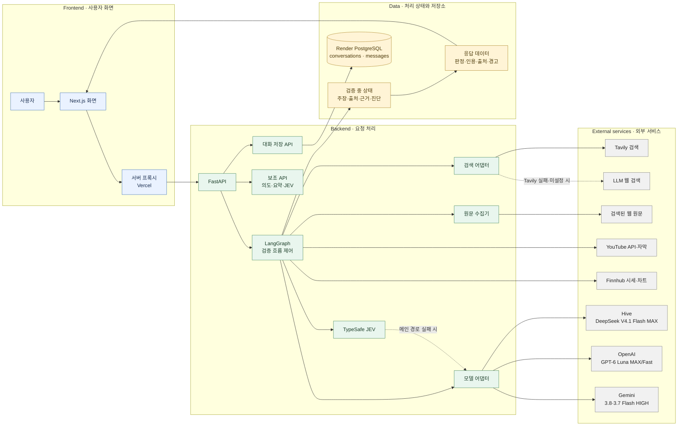
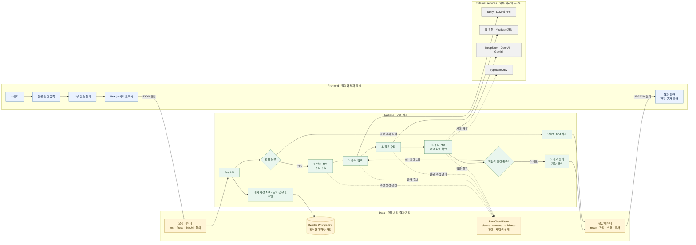

# True or Not

True or Not은 Next.js 프론트엔드와 FastAPI·LangGraph 백엔드로 사용자의 주장과 원문 근거를 연결해 확인하는 검증 애플리케이션입니다. 확인된 내용과 불확실성을 함께 보여줍니다. 제품 정책, 현재 코드, 남은 작업, 배포 및 QA 기준은 [문서 안내](docs/README.md)를 참고하세요.

## 시스템 구성도



Auto 모델은 설정된 공급자 중 DeepSeek V4.1 Flash MAX, GPT-6 Luna MAX/Fast, Gemini 3.8/3.7 Flash HIGH 순서로 시도합니다. DeepSeek는 서버 전용 `HIVE_API_KEY`와 Hive API를 사용합니다. 공급자 키와 DB 연결 정보는 백엔드에만 설정하세요.

## 검증 아키텍처 구성도



세부 흐름, API 계약, 모델 설정, 재탐색 조건과 제한값은 [아키텍처](docs/아키텍처.md)에서 확인합니다. 완료·남은 작업과 미결정 정책은 [작업현황](docs/작업현황.md), 실제 검증 결과는 [QA 실행기록](docs/qa/실행기록/)을 따릅니다.

## 개발 환경 시작

Docker 구성과 같은 Node.js 24 및 npm을 권장합니다. 저장소 루트에서 실행합니다.

```bash
npm ci
npm run dev
```

브라우저에서 `http://localhost:3000`을 엽니다. 팩트체크를 실행하려면 별도 터미널에서 백엔드도 실행해야 합니다. 백엔드 설치와 키 설정은 [백엔드 안내](backend/README.md)를 참고하세요.

프론트엔드는 기본적으로 `http://127.0.0.1:8010`의 백엔드에 연결합니다. 다른 로컬 포트를 쓸 때는 Next.js 서버 환경 변수 `FACTLENS_BACKEND_URL`에 `http://127.0.0.1:<포트>` 또는 `http://[::1]:<포트>`를 지정하고 프론트엔드 서버를 다시 시작하세요. 기본 프록시는 두 루프백 호스트만 허용합니다. Render 원격 HTTPS 연결은 배포 설정으로 활성화합니다.

## npm 명령

| 명령 | 설명 |
|---|---|
| `npm run dev` | 개발 서버 실행 |
| `npm run build` | 프로덕션 빌드 생성 |
| `npm run start` | 생성된 프로덕션 빌드 실행 |
| `npm run typecheck` | TypeScript 타입 검사 |
| `npm test` | Node 테스트 실행. 요약·JEV API 경계 테스트 포함 |

## 자동 검증 (CI)

[GitHub Actions CI](.github/workflows/ci.yml)는 main 푸시, PR, 수동 실행에서 프론트엔드 테스트·타입 검사·프로덕션 빌드와 백엔드 잠금 파일 검사·pytest를 병렬로 실행합니다. Node.js 24와 Python 3.12를 사용하며 `npm ci`, `uv sync --frozen`으로 잠금 파일 기준 의존성을 설치합니다.

CI에는 실제 모델 공급자 키와 DB URL을 전달하지 않습니다. 따라서 오프라인 회귀 테스트 통과만으로 실제 LLM·검색·DB 연결이나 Render 배포 성공을 의미하지 않습니다. 실행 범위와 미검증 항목은 [QA 실행기록](docs/qa/실행기록/)에서 확인하세요.

## 주요 디렉터리

- `app/page.tsx`, `app/layout.tsx`: Next.js 페이지와 공통 레이아웃
- `app/api/fact-check/route.ts`: 브라우저 요청을 백엔드에 전달하는 서버 측 프록시
- `app/components/`: 팩트체크 입력·대화와 결과 대시보드 UI
- `app/lib/`: API 계약, 점수 계산, 출처 탐색 및 서버 유틸리티
- `backend/`: FastAPI·LangGraph 팩트체크 백엔드

## 프로덕션 실행

```bash
npm run build
npm run start
```

프로덕션에서도 백엔드가 실행 중이어야 합니다. LLM 제공자 키는 백엔드에만 설정하고 브라우저나 `NEXT_PUBLIC_` 변수에 넣지 마세요.

## 대화 저장·불러오기

대화 저장은 기본적으로 꺼져 있으며, 사용자가 저장에 동의한 뒤의 메시지를 익명 브라우저 세션으로 Render PostgreSQL에 저장합니다. 저장된 대화는 목록·복원·이어쓰기·삭제할 수 있습니다. 저장 설정과 선택 유지 동작은 [QA 기록](docs/qa/실행기록/2026-10-05-저장선택유지.md)을 참고하세요.

DB 연결 정보와 서명 키는 백엔드에만 설정합니다. 설정과 마이그레이션은 [백엔드 안내](backend/README.md#대화-저장--render-postgresql), 확인 범위와 남은 검증은 [대화 저장 실행 기록](docs/qa/실행기록/2026-10-04-대화저장.md)을 참고하세요. 쿠키를 지우거나 만료하면 기존 대화에 접근할 수 없습니다. 무료 시연 DB는 2026년 11월 3일 만료 예정이며 영구 보관이나 백업을 보장하지 않습니다.

## 배포

프론트엔드는 [Vercel](https://true-or-not-ten.vercel.app)에 배포되어 있습니다. `render.yaml`은 AIO 2기 워크스페이스의 Render 백엔드와 PostgreSQL 구성을 정의하며, 내부 DB 연결·배포 전 테이블 생성·서명 키 생성을 포함합니다. 백엔드는 `0.5c-512mb`, PostgreSQL은 `0.1c-256mb`와 1GB 디스크 구성입니다. Render 적용 및 원격 통합 검증 상태는 [배포 안내](docs/배포.md)와 [배포 실행 기록](docs/qa/실행기록/2026-10-12-Render배포.md)을 확인하세요.
