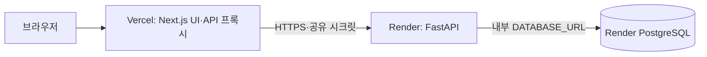
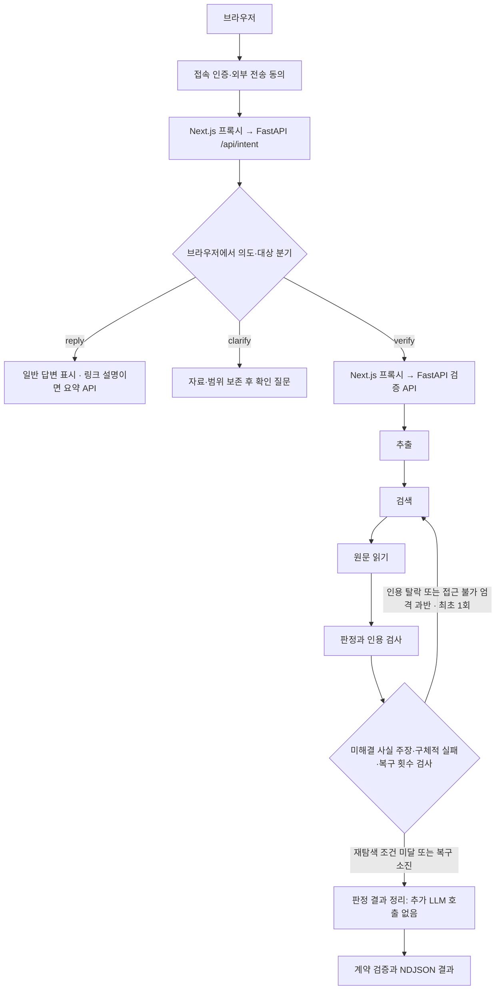
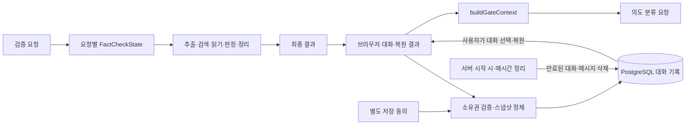
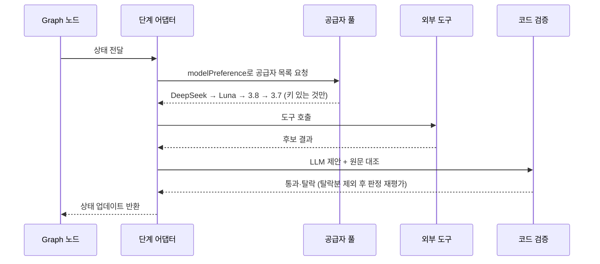

# True or Not 아키텍처

기준일: 2026-10-15. 역할: 현재 코드의 에이전트 구조·흐름·상태·도구 정의와 배포 구성. 제품 정책은 [기획서](기획서.md), 문제·미결정 사항은 [작업현황](작업현황.md)와 [Agent 작업현황](agent/agent_작업현황.md), 실행 증거는 [QA](qa/검증기준.md)에서 관리한다.

## 핵심 요약

- 요청 의도를 먼저 `verify`·`reply`·`clarify`로 분류하고, 브라우저가 검증 실행·일반 답변·확인 질문 경로를 선택한다.
- 검증은 LangGraph의 추출 → 검색 → 읽기 → 판정 → 결과 정리 5개 노드로 실행한다. 판정 중 근거 부족과 구체적인 수집·인용 실패가 확인되면 검색부터 최대 1회 반복한다.
- 검색 후보·LLM 판정은 제안으로 취급하며 실제 원문과 인용·참조 무결성을 코드로 확인한다. 결과 정리에는 추가 LLM을 호출하지 않는다.
- 브라우저 대화 맥락, 요청별 그래프 상태, 동의한 대화의 DB 저장을 구분한다. 새 대화의 보관 기한은 서명된 익명 세션의 만료 시각이며 서버가 만료 기록을 자동 정리한다.
- Vercel의 화면·API 프록시, Render의 FastAPI·PostgreSQL로 배포한다. 접속 비밀번호 인증과 대화 저장 소유권은 별도 쿠키로 관리한다.

## 1. 서비스 개요

- 서비스명: True or Not
- 목적: 기사·댓글·온라인 주장에서 확인할 주장을 추출하고, 원문 인용·수치·날짜·비교 조건을 연결해 확인된 내용과 불확실한 내용을 함께 보여주는 생활형 검증 도구다. 정답을 선언하지 않는다.
- 주요 사용자: 온라인 주장에 의문을 가진 일반 사용자
- 연계 도구: Tavily 검색·Extract, LLM 웹검색(OpenAI·Gemini), 제한된 Playwright 원문 읽기, YouTube Data API·자막, Finnhub 시세, KOSIS 소비자물가지수, TypeSafe JEV 판정, PostgreSQL 대화 저장
- 배포 구성: 브라우저와 Next.js 프런트·서버 프록시는 Vercel, FastAPI 백엔드와 PostgreSQL은 Render에 배포한다.
- 연결 경계: 브라우저는 Vercel API 경로를 통해 Render 백엔드에 요청한다. Vercel 프록시는 서버 간 공유 시크릿을 전달하고, Render 백엔드만 내부 `DATABASE_URL`로 PostgreSQL에 연결한다. DB 접속 정보는 브라우저에 전달하지 않는다.

## 2. StateGraph 노드

그래프 정의는 [workflow.py](../backend/workflow.py), 실행 어댑터는 [runtime.py](../backend/runtime.py)가 맡는다. 등록된 노드는 아래 5개다. 그래프 밖의 `/api/intent`는 텍스트·링크·이미지·이전 맥락으로 요청 의도와 대상을 분류하며 같은 LLM 호출에서 일반 답변이나 확인 질문을 작성한다. 분류 실패 시에는 브라우저의 제한된 규칙 기반 대체 경로를 사용한다.

| 노드 | 사고 흐름 | 역할 | 주요 입력 | 주요 출력 |
|---|---|---|---|---|
| extracting | 인지 | 최대 3개 주장·검색어 생성, 원문 위치 검증 | text, focus, linkUrl, image | claims, searchQueries |
| searching | 행동 | 일반·주장별 YouTube 검색. Tavily 실패 시 LLM 웹검색 대체. 조건에 따라 Finnhub·KOSIS 연결 | searchQueries | sources 후보, market |
| reading | 행동 | 안전한 입력 링크·검색 후보 URL 읽기, 조건부 Playwright·Tavily Extract 복구 | sources 후보 | sources, sourceTexts |
| verifying | 판단 | LLM 판정 제안 → 인용·참조 무결성 코드 검증. JEV 모드 실패 시 LLM 판정으로 전환 | claims, sourceTexts | claims 확정, evidence, diagnostics |
| synthesizing (호환 단계명) | 검증 | 추가 LLM 호출 없이 판정·근거의 최종 계약 검증 및 결과 정리 | claims, evidence, sources | judgment_only, result |

`review_recovery`는 별도 그래프 노드가 아니라 `verifying` 어댑터 안에서 호출하는 판단 함수다. `recoveryRequested`·`recoveryCount`를 갱신하고 그래프의 조건부 간선이 검색 반복 또는 결과 정리를 선택한다.

- 추출: 링크 단독 본문은 모델 호출 전 UTF-16 12,000 단위로 자르며 이미지 관측 본문은 입력 본문을 대체한다.
- 검색: 사용자가 제공한 안전한 링크와 실제 검색 메타데이터 URL을 수집 대상으로 삼는다. 최대 3개 주장에 대해 관련 YouTube 동영상도 별도 검색하며, 검색 결과 6개 한도에서 관련 영상이 있으면 한 자리를 확보한다. 일본어 후보·본문 제외 규칙과 Naver Knowledge iN 제외가 있다.
- 읽기: 본문·섹션·제목·최종 URL을 수집한다. 기본 HTTP 읽기는 최대 4건 병렬이며, 본문이 비어 있는 일부 HTML에만 Playwright를 읽기 묶음당 최대 1회 사용한다. 안전한 웹 URL의 수집 실패는 Tavily Extract로 묶어서 1회 복구하며, 유튜브·내부 IP·요청하지 않은 URL·검색 요약문은 복구 원문으로 채택하지 않는다. 링크 제목의 추가 검색은 Tavily가 있을 때 수행하며 재탐색 때 반복하지 않는다.
- 판정: 주장 주변 문장·기사 정보를 전달하고 [수치 계산 보조](../backend/compute.py)로 같은 명시적 단위의 변화만 계산한다. 단위 없음·다른 지표·환산·범위·분수·연도·비율/퍼센트포인트·음수·지수 표기는 생략한다.
- 최종 구성: 별도 합성 LLM을 모든 메인 검증 입력에서 제거하였다. 채팅은 판정의 요약·확인된 내용·미확인 내용·경고·검증 근거를 직접 표시한다. 예측·의견을 사실 판정으로 바꾸지 않으며 별도 종합 설명은 생성하지 않는다. [합성 제거 검증](qa/실행기록/2026-10-08-합성제거.md)을 따른다.

기준 코드: [workflow.py](../backend/workflow.py), [runtime.py](../backend/runtime.py), [verification.py](../backend/verification.py), [answer_synthesis.py](../backend/answer_synthesis.py).

### 관련 구간과 근거 패킷 입력

[evidence_context.py](../backend/evidence_context.py)는 판정 입력에 사용할 검색어 일치 구간 앞뒤 450자를 병합한다. 일치 구간이 없거나 전체 선택 범위가 6,000자를 넘으면 앞부분으로 돌아가며 `selection=fallback`으로 표시한다. 자료는 `passages[{start,end,text}]`로 전달하고 서버에 보존한 원문과 인용을 대조한다. 최종 합성용 입력 패킷은 합성 호출과 함께 제거하였다. [기존 판정 입력 검증](qa/실행기록/2026-10-06-근거패킷.md)을 따른다.

## 3. 상태 흐름도

### 그래프 종료 조건

| 종료 | 조건 | 결과 |
|---|---|---|
| 정상 완료 | 판정 및 최종 계약 검증 완료 | 판정·근거 직접 표시(`judgment_only`) |
| 근거 부족 종료 | 검증된 인용 없음 | 근거 부족 판정·불확실성을 그대로 표시 |
| 복구 소진 종료 | `recoveryCount >= 1` | 재탐색 없이 결과 정리 |
| 검증 불가 종료 | 의견·예측·입력 오류 | `not_checkable` 또는 오류 코드 |
| 취소 종료 | 브라우저 취소·문서 이탈 | upstream 취소 전파, 늦은 결과 무시 |

## 4. 분기 조건과 예외 폴백

| # | 분기 위치 | 조건 | 참일 때 | 거짓일 때 |
|---|---|---|---|---|
| F1 | 구조화 모델 호출 | `modelPreference == "auto"` | DeepSeek → Luna → 3.8 → 3.7 순으로 시도 | 지정 모델만 단독 사용, 실패 시 전환 없음 |
| F2 | 검색 수단 | Tavily 키 설정 + 호출 성공 | Tavily 결과 사용 | LLM 웹검색 대체. 둘 다 불가 시 `LLM_SEARCH_UNAVAILABLE` 경고 |
| F3 | 링크 입력 | 본문이 링크 URL 단독과 일치 | 페이지 본문 수집 후 그 본문으로 추출 | 입력 텍스트로 추출 |
| F4 | JEV 검증 실패 | `JevError` 발생 | 파이프라인 내부 LLM 판정으로 전환. `/jev` 단독 경로는 오류 반환 | JEV 결과 사용 |
| F5 | 최종 결과 정리 | 판정 완료 | 별도 공급자 호출 없이 최종 결과 반환 | 판정·계약 검증 오류는 검증 실패로 반환 |
| F6 | 시장 맥락 | 종목 탐지 + Finnhub 응답 성공 | 시세·차트 첨부 | 맥락 생략 후 검증 계속 |
| F7 | 유튜브 | API 키 설정 + 영상·댓글 조회 성공 | 정보·댓글 수집 후 별도 자막 조회. 자막 성공 시에만 검증 원문으로 사용 | 정보 수집 상태와 자막 확인 상태를 별도로 표시 |
| F8 | 재탐색 | 근거 부족 + (인용 탈락 or 접근 불가 엄격 과반·2건 이상) | 검색어에 "공식 원문" 추가, 실패 URL 제외 후 최대 1회 재실행 | 경고를 붙이고 결과 정리 |
| F9 | 웹 원문 복구 | 안전한 웹 URL 읽기 실패 + Tavily 설정·전송 동의 | 실패 URL 묶음을 Extract로 복구 | 접근 불가 상태 유지 |
| F10 | 공식 물가 자료 | KOSIS 키 설정 + 전국 월별 소비자물가 관련 주장 | 공식 자료 후보를 출처 상한 내에 추가 | 기존 검색 결과 유지 |

유튜브 출처가 있는 실제 검증 결과는 오른쪽 ‘선택한 주장과 근거’ 아래의 ‘유튜브 정보·댓글’ 패널에서 제목·썸네일·채널·게시일·조회수와 공개 댓글을 표시합니다. 주장 개수와 관계없이 표시하며 댓글은 펼쳐 볼 수 있습니다. 댓글은 참고 맥락이고 AI 판정·인용 근거에 사용하지 않습니다. 조회 설정 누락·댓글 없음·조회 실패를 구분하며, 영상 정보·댓글의 저장·내보내기 제외 규칙은 기존 계약을 따릅니다.

`youtubeDataStatus=collected`와 `accessStatus=verified`는 별개다. 정보·댓글은 수집했지만 자막을 읽지 못했다면 `정보·댓글 수집 완료 · 자막 미확인`으로 표시한다. 댓글을 자막이나 원문 근거로 대체하지 않는다.

## 5. 공유 상태 객체

`FactCheckState`(`backend/workflow.py`, `TypedDict`, `total=False`)가 유일한 공유 상태다.

| 필드 | 타입 | 쓰는 노드 |
|---|---|---|
| `text`, `focus`, `consent`, `modelPreference` | str, str, bool, str | 진입·extracting |
| `linkUrl`, `image`, `jevMode` | str\|None, dict\|None, bool | 진입·extracting |
| `claims`, `searchQueries` | list, dict | extracting → searching·verifying |
| `searchNotice`, `stockSymbols`, `market` | str, list, dict\|None | searching |
| `sources`, `sourceTexts`, `sourceSections` | list, dict, dict | reading → verifying·synthesizing |
| `evidence`, `diagnostics` | list, list | verifying → review·synthesizing |
| `claimSnapshot`, `excludedSourceUrls` | list, list | review → searching(재탐색) |
| `recoveryRequested`, `recoveryCount`, `recoveryTrace` | bool, int, list | review (최대 1회) |
| `answer`, `answerModel`, `answerReasoning` | dict, str\|None, str\|None | synthesizing |
| `llmModel`, `llmReasoning`, `result` | str, str, dict | verifying·synthesizing |

### 상태 중복 제거 기준

- URL 정규화(추적 파라미터·`www`·슬래시·쿼리 순서) + 리다이렉트 최종 URL 비교로 문서 중복을 제거한다. 출처는 최대 6개·같은 사이트 2개다.
- 공통 문구(공백 정규화 본문 앞 6,000자에서 60자 이상 공통 인용)가 있으면 `shared-*` 그룹으로 묶는다. 계보·독립성 미확인은 경고로 남긴다(T20에서 개선).
- 대화 저장은 요청 식별값 멱등(`requestId` 중복 생성 방지), 동일 메시지 중복 저장을 DB 제약으로 막는다.
- 현재 `FactCheckState`는 28개 필드를 선언한다. 표는 역할별로 묶었으며 전체 타입의 기준은 `workflow.py`다. 노드·필드·복구 횟수를 변경하면 본 표를 갱신한다.

## 6. 기억·컨텍스트·요약 전략

브라우저의 대화 맥락, 백엔드 요청 상태, DB의 대화 기록은 보관 위치와 사용 방식이 다르다. 자동 장기 기억 검색·벡터 검색·대화 압축 모델은 사용하지 않는다.

| 구분 | 저장 위치 | 사용 방식 | 수명 |
|---|---|---|---|
| 대화 맥락 | 브라우저 React 상태 | 최근 메시지·직전 검증 정보를 골라 intent 요청에 포함 | 현재 화면. DB 기록을 선택하면 복원 가능 |
| 검증 작업 상태 | 백엔드 `FactCheckState` | 5개 노드와 조건부 재탐색 사이의 주장·검색어·원문·근거 전달 | 요청 범위. 영속 체크포인터·재시작 복구 없음 |
| 대화 기록 | Render PostgreSQL | 저장 동의 후 메시지·정제된 결과 저장, 소유권 확인 후 목록·복원 | `expires_at`까지 접근 가능, 만료 후 주기적 물리 삭제 |

### 6.1 요청 상태와 대화 맥락

`FactCheckState`는 28개 필드를 선언한 `TypedDict`이며 요청 처리에 필요한 원문·주장·출처·근거·진단을 전달한다. 서버 재시작 후 이어서 실행할 저장소나 `runId`는 없다. 요청 종료 후 참조가 해제된 객체는 런타임의 메모리 회수 대상이 되며 즉시 소거를 보장하지 않는다.

[buildGateContext](../app/components/chat-intent.ts)는 현재 브라우저 상태에서 최근 사용자 메시지 3개(각 200자), 답변 2개(각 1,500자), 직전 원문 최대 2,000자, 주장 최대 3개, 출처 최대 6개와 경고 최대 8개를 골라 보낸다. 확인 질문에 대한 후속 요청에서는 보존한 입력·이미지·링크 정보를 함께 사용한다. 백엔드가 DB 전체 이력을 자동 검색해 맥락을 만들지는 않는다.

### 6.2 대화 저장과 만료 삭제

저장은 기본 꺼짐이며 외부 전송 동의와 별도로 켠다. `conversations`에는 대화 소유자·제목·보관 기한을, `messages`에는 메시지와 정제된 결과 스냅샷을 저장한다. HMAC-SHA256은 세션 토큰의 위변조를 확인하는 서명이며 암호화가 아니다. 소유권 쿠키는 30일 유효한 `HttpOnly`·`SameSite=Lax` 쿠키이고 HTTPS에서는 `Secure`를 적용한다.

- 신규 대화의 `expires_at`은 서버가 서명을 검증한 익명 세션의 원래 만료 시각이다. 같은 세션에서 새 대화를 만들거나 이어 써도 30일을 다시 계산하지 않는다.
- `002_conversation_expiry.sql`은 기존 기록을 소유자별 가장 이른 대화 생성 시각 + 30일로 이관한다. 과거 세션 발급 시각은 DB에 없어 기존 기록의 정확한 세션 만료 시각은 복구할 수 없다. 같은 소유자가 새 대화를 만들면 검증된 세션 만료 시각으로 더 늦게 잡힌 기한을 당긴다.
- 백엔드는 시작 시와 이후 매시간 만료된 `conversations` 행을 물리 삭제한다. 외래 키의 `ON DELETE CASCADE`가 연결된 `messages`도 삭제한다. 정상 가동 중 삭제 지연은 정리 주기인 최대 1시간이며, 서버 중단 중 만료된 기록은 재시작 후 정리한다. DB 장애 시 실패를 비밀정보 없이 기록하고 다음 주기에 재시도한다.
- 쿠키를 미리 삭제하거나 서명 키를 바꾸면 기록 접근이 끊기지만 보관 기한이 앞당겨지지는 않는다. 사용자는 만료 전에도 단일·전체 삭제 API를 사용할 수 있다. 수동 삭제는 메시지·제목을 제거하고 멱등성을 위한 삭제 표식을 남기며, 만료 정리가 이 행도 제거한다.
- `create_request_id`·`(conversation_id, request_id, role)` 유니크 제약과 행 잠금으로 재시도 중복·메시지 순서 충돌을 막는다. 풀은 최대 4개, DB 작업 제한은 3초다. 종료 시 정리 작업을 취소·회수한 뒤 풀을 닫는다.

저장 허용 범위는 사용자 입력·판정·확인/미확인 내용·검증된 인용·출처 메타데이터·검증 시각이다. 새 결과는 `judgment_only`이며 개요·결론 생성 블록은 없다. 과거 생성 답변은 저장·복원 호환만 유지한다. 수집 문서 전문·첨부 이미지·시장 원시 데이터·YouTube API 메타데이터·댓글·공급자 원시 응답·비밀값은 저장하지 않는다.

기준 코드: [세션 검증](../backend/conversation_session.py), [저장소·정리 작업](../backend/conversation_store.py), [마이그레이션](../backend/migrations/002_conversation_expiry.sql), [API 수명 주기](../backend/main.py), [스냅샷 정제](../app/lib/conversation-contract.ts).

### 6.3 컨텍스트 상한과 요약

- 입력은 UTF-16 12,000 단위, 확인 요청은 500 단위, 이미지 디코딩 결과는 1,500,000바이트 이하로 제한한다.
- 판정에는 출처당 최대 6,000자의 발췌를 사용한다. 검색어 일치 구간 앞뒤 450자를 병합하고 범위를 넘으면 앞부분으로 돌아간다. 문자 수 제한은 정확한 토큰 수 계산과 구분한다.
- 대화 복원은 최대 100개 메시지를 읽고 응답이 491,520바이트를 넘으면 오래된 메시지를 다음 페이지로 분리한다. 메시지 1개의 경우 추가 분할하지 않는다.
- `/api/summarize`는 사용자가 요청한 내용 설명·요약을 위한 별도 경로이며 장기 기억 압축이나 사실 판정을 수행하지 않는다.

## 7. 도구 명세

Function Calling은 LLM 자율 호출이 아니라 단계 어댑터가 조건에 따라 호출하는 프로그래밍 방식이다. LLM은 구조화 출력으로 제안하고 실제 호출·검증은 코드가 수행한다.

| 도구 | 입력 | 출력 | 실패 처리 |
|---|---|---|---|
| Tavily 검색 | 주장 검색어·링크 제목 | 후보 URL·제목·발행일 | 주장별 YouTube 도메인 제한 검색 추가(최대 3건, 건당 1 credit). 개별 YouTube 검색 실패는 일반 결과를 유지하며, 기본 검색 실패 시 LLM 웹검색으로 대체 |
| LLM 웹검색 | 검색어 | 후보 URL·요약 | Tavily 미설정·실패 시 주장별 YouTube 전용 검색도 별도 실행. 실패 시 `LLM_SEARCH_UNAVAILABLE` 경고, 스니펫은 인용으로 쓰지 않음 |
| HTTP 원문 수집 | 안전한 입력 링크·후보 URL | 본문·섹션·최종 URL | 요청당 8초·512,000바이트 제한, 사설망·리다이렉트 검사 |
| Playwright 보조 읽기 | 본문이 비어 있는 일부 HTML URL | 렌더링된 본문 | 읽기 묶음당 최대 1회·7초. 모든 403 응답에 실행하는 우회 경로는 아님 |
| Tavily Extract | 안전한 웹 수집 실패 URL 묶음 | `raw_content` 원문 | 전체 10초·응답 1MiB·원문 출처당 18,000자. 실패 시 기존 접근 불가 상태 유지 |
| YouTube Data·자막 | 영상 URL | 정보·댓글 최대 10개, 별도 자막 상태 | 정보·댓글 수집과 자막 확인 여부를 분리. 댓글은 판정·인용 미사용 |
| Finnhub 시세 | 종목 심볼 | 현재가·60일봉 | 실패해도 검증 계속 |
| KOSIS 물가 | 전국 월별 소비자물가 관련 주장 | 공식 소비자물가지수 출처 후보 | 키 미설정·조건 미충족·실패 시 기존 검색 유지 |
| LLM 판정 | 주장·발췌·인용 | 판정·요약·확인/미확인 내용·근거 | 90초 타임아웃, 인용 불일치는 탈락 후 판정 재평가, Auto는 다음 공급자 시도 |
| PostgreSQL 저장·정리 | 동의된 메시지·서명된 세션 만료 시각 | 목록·복원, 만료 대화·메시지 삭제 | 풀 4개·3초 제한, 저장 실패 시 답변 유지. 정리 실패는 다음 주기 재시도 |

## 구성과 모델

Next.js App Router UI와 서버 프록시가 FastAPI·LangGraph 백엔드에 연결된다. 모델·검색 키는 서버에만 둔다. 브라우저에 공급자 키를 전달하지 않는다.

| Auto 순서 | 모델 | 모든 해당 모델 호출의 추론 설정 | 공급자 API |
|---|---|---|---|
| 1 | DeepSeek V4.1 Flash (`deepseek-v4.1-flash`) | `reasoning_effort=max`, JSON 모드 + 서버 검증 | Hive V3 Chat Completions |
| 2 | GPT-6 Luna (`gpt-6-luna`) | `reasoning.effort=max`, `service_tier=fast` | OpenAI Responses |
| 3 | Gemini 3.8 Flash | `thinking_level=high` | Gemini Interactions |
| 4 | Gemini 3.7 Flash | `thinking_level=high` | Gemini Interactions |

키가 없는 공급자는 제외하고 Auto는 단계별 실패 시 설정된 다음 공급자를 시도한다. 개별 모델의 구조화 호출은 해당 모델만 사용한다. 기준은 [providers.py](../backend/providers.py)와 [schemas.py](../backend/schemas.py)다. API 인증·과금은 ChatGPT/Codex 구독과 별개다.

웹검색 공급자는 구조화 모델 선택과 별도로 정한다. Hive는 공급자 기본 웹검색 도구를 제공하지 않아 DeepSeek 선택 시에도 Tavily 대체 검색에는 설정된 OpenAI·Gemini를 사용할 수 있다.

## 보조 경로와 출처

| 경로·데이터 | 현재 동작 |
|---|---|
| intent | 텍스트·이미지·링크·이전 맥락으로 검증·일반 답변·확인 질문과 현재/이전 대상을 분류. 필수 `consent: true`를 타입 변환 없이 검사 |
| 내용 요약 | 붙여넣기·링크·30분 미만 영상 자막 요약. 사실 판정·이미지 요약은 하지 않음 |
| 메인 그래프 JEV 옵션 | 추출 후 JEV 판정. 실패 시 LLM으로 전환하며 현재 전환 안내가 부족 |
| JEV 빠른 API | 입력 전체를 `fact` 주장 하나로 만들고 검색→읽기→JEV 판정. 이미지 거부. 실패는 오류 또는 LOW_CONFIDENCE 유보 처리 |

## API와 계약

| 브라우저 프록시 | 백엔드 | 용도 |
|---|---|---|
| 없음 | GET `/health` | 생존·리비전. Docker의 리비전 식별 공백은 T16 |
| GET `/api/fact-check` | GET `/api/fact-check` | 모델·설정·워크플로 상태 |
| POST `/api/fact-check` | POST `/api/fact-check/stream` | NDJSON 검증 |
| 없음 | POST `/api/fact-check` | 단일 JSON 검증. QA 실행기가 사용 |
| POST `/api/fact-check/jev` | 같은 경로 | JEV 빠른 판정 |
| POST `/api/intent` | 같은 경로 | 의도 분류·대화 |
| POST `/api/summarize` | 같은 경로 | 내용 요약 |
| `/api/conversations/*` | 같은 경로 | 상태·익명 세션·대화 생성·목록·복원·메시지 추가·단일/전체 삭제 |
| `/api/access/login`, `/api/access/logout` | 없음 | 공유 비밀번호 접속 인증·로그아웃 |

요청·결과의 전체 필드는 [schemas.py](../backend/schemas.py), [contracts.py](../backend/contracts.py), [프론트 계약](../app/lib/fact-check-contract.ts)을 따른다.

- 요청: `text`, `focus`, `consent=true`, `modelPreference`, 선택적 `linkUrl`·`image`, `jevMode`. 알 수 없는 필드는 거부한다.
- 최초 동의(T11): 첫 외부 POST 전에 안내·사용자 선택을 받는다. 안내 버전만 localStorage에 저장하며 철회·사이트 데이터 삭제·버전 변경 시 재확인한다.
- 결과: 원문·주장·출처·근거·판정·경고·검증 시각·모델·추론·개요·선택적 시장 맥락. 주장·출처·근거 ID와 인용 무결성을 검사한다. 발행일 미확인은 `null`이다.
- 원문 위치: UTF-16 코드 단위 `start` 포함·`end` 제외.
- 판정 코드: `mostly_supported`, `partially_supported`, `missing_context`, `conflicting_sources`, `insufficient_evidence`, `not_checkable`, `contradicted`.
- 답변 상태: 메인 검증은 `judgment_only`(판정 직접 표시, 생성 블록·생성 모델 없음)를 반환한다. 과거 저장 결과·예시의 `grounded`, `partial`, `insufficient_evidence`, `synthesis_failed`는 읽기 호환을 유지한다. `partial`도 인용이 있는 개요·결론을 요구하며 생성 중단 안내를 표시한다. JEV 빠른 경로는 기존 점수 전용 상태를 유지한다.
- 점수 밴드: 0~19·20~39·40~59·60~79·80~100. 판정과 별개로 읽는다. 표시 정책은 D1 미결정이다.

## 제한과 스트림

| 항목 | 현재 코드 값 |
|---|---|
| 본문·확인 요청 | UTF-16 12,000·500 단위 |
| 링크·이미지 | 링크 2,048자, HTTP(S)·자격증명/명시적 포트 불가. JPEG/PNG/WebP, 디코딩 1,500,000바이트 이하 |
| 주장·출처 | 최대 3개·6개. 링크 본문과 후보를 같은 상한 안에서 처리 |
| 최종 결과 정리 | 추가 모델 호출·출력 토큰·재시도 없음. 기존 판정·근거·경고를 보존 |
| 기본 본문 읽기 | URL당 전체 8초·응답 512,000바이트, 최대 4건 병렬 |
| 보조 본문 복구 | 조건부 Playwright 7초·묶음당 1회, 이후 Tavily Extract 전체 10초·응답 1MiB. 읽기 전체가 8초 안에 끝난다는 의미는 아님 |
| 모델·Tavily | 모델 클라이언트 90초, Tavily 쿼리별 요청 20초. YouTube 전용 Tavily 검색은 주장별 병렬 실행 |
| 메인 스트림 | 백엔드 240초, 프록시 245초, 프록시 응답 총 2MB |
| 보조 프록시 | JEV 180초, intent upstream 45초·요청 읽기 5초, 요약 120초 |
| 동시 실행 | 메인 프록시 프로세스당 10건. JEV 빠른 경로의 별도 상한은 없다 |
| 본문 크기 검사 | 메인·intent 제한 읽기 3,000,000바이트, JEV 200,000. 요약은 전체 읽기 후 20,000자 검사 |
| 대화 보관 정리 | 신규 대화는 익명 세션 만료 시각, 서버 시작 시·매시간 물리 삭제. 중단·DB 장애 시 다음 실행에 재시도 |

NDJSON은 `stage`·`sources`·`preview`·`result`·`error`를 전달한다. 검색→읽기→검증은 재탐색 때 한 번 반복할 수 있다. 취소는 별도 API 대신 연결 종료와 upstream 취소로 전파한다. 메모리 기반 실행이며 `runId`·영속 큐·재시작 후 작업 복구는 없다.

화면 상단의 ‘총 경과 시간’은 의도 분석을 포함한 요청 시작부터 누적하며 100ms마다 갱신합니다. 단계 변경·재탐색에도 시작 시각을 유지하고 완료·오류·취소 시에는 종료 시점의 값을 고정합니다. 출처 후보 옆의 ‘검색’과 가져온 원문 옆의 ‘읽기’는 각 단계 시작 신호부터 결과 수신까지의 소요 시간이며 재탐색 때 새로 측정합니다. 시작 신호가 없으면 생략합니다. ‘1차 요약’은 요청 시작부터 해당 결과 수신까지의 누적 시간입니다. 브라우저 측정값이므로 서버 내부 실행 시간과는 구분합니다.

주요 공개 오류는 `INVALID_REQUEST`, `LOCAL_ONLY`, `BUSY`, `CANCELLED`, `NOT_CONFIGURED`, `AGENT_FAILED`, `BACKEND_UNAVAILABLE`, `BACKEND_FAILED`, `TIMEOUT`, `INTENT_FAILED` 및 JEV 오류 코드다. 구현 기준은 [main.py](../backend/main.py), [streaming.py](../backend/streaming.py), [메인 프록시](../app/api/fact-check/route.ts)다.

## 데이터·운영 경계

기본 프록시는 로컬 요청과 loopback HTTP 백엔드를 제한한다. Render 공개·원격 HTTPS 게이트와 서버 공유 시크릿은 [배포](배포.md)에서 설정한다.

검증·intent·JEV·요약 API는 `consent: true`를 필수로 검사합니다. 브라우저는 최초 안내에서 사용자가 선택한 동의를 재사용하며 철회·사이트 데이터 삭제·안내 버전 변경 시 다시 확인합니다. 사설 IP·DNS·리다이렉트 검증은 [sources.py](../backend/sources.py)에 구현되어 있습니다. 이미지 MIME과 실제 바이트 대조는 미구현입니다.

공개 화면과 API는 [공유 비밀번호 게이트](../app/lib/server/access.ts)로 보호합니다. 접속 쿠키 `ton_access`는 24시간 유효하고, 익명 대화 소유권 쿠키 `ton_session`의 30일 수명과 별개입니다. 비밀번호·서버 공유 비밀키가 설정되지 않은 공개 환경은 접근을 차단합니다. 개인 계정·기기 동기화·접속 시도 속도 제한은 제공하지 않습니다.

정식 로그인·계정은 제공하지 않지만 저장에 동의한 대화 메시지와 최소 검증 결과 스냅샷은 실제 Render PostgreSQL의 `conversations`·`messages` 테이블에 영속 저장한다. 구현 기준은 [대화 프록시](../app/lib/server/conversation-proxy.ts), [저장 API](../backend/conversation_api.py), [저장소](../backend/conversation_store.py)다.

익명 소유권은 서버가 검증하는 30일 HttpOnly 서명 쿠키로 확인하고 저장 동의는 별도 기본 꺼짐이다. 세션 만료 후 DB 자동 삭제는 6.2절의 보관 기한·정리 주기를 따른다. 전체 수집 원문·첨부 바이너리·공급자 원시 응답·서비스 비밀값·YouTube API 메타데이터·댓글은 대화 결과 스냅샷 저장에서 제외한다.

공식 API 참고: [OpenAI Responses·웹검색](https://developers.openai.com/api/docs/guides/tools-web-search), [구조화 출력](https://developers.openai.com/api/docs/guides/structured-outputs), [Gemini Interactions](https://ai.google.dev/gemini-api/docs/interactions-overview). 실제 공급자 권한·요금·원격 성공은 QA 기록과 구분한다.
